# translate.js — DOM runtime review

Date: 2026-11-08  
Version: `4.1.0.20260526`  
Method: local Playwright fixtures + mocked `translate.json` / `language.json`; no external translation provider.

## Result

**Baseline: 16/21 checks pass; with #112 and #113 applied: 20/21 (Shadow DOM remains open).** The core translation path is solid; the failures are in storage resilience, nested iframes, Shadow DOM and cache control. A cross-origin `postMessage` behavior is also documented as a security finding.

| Check | Baseline | Fixed by |
|---|---|---|
| Static translation, selector, attributes, ignore rules | PASS | — |
| Dynamic `childList` and `characterData` updates | PASS | — |
| Language switch and cache hit on reload | PASS | — |
| Same-origin iframe injection | PASS | — |
| `localStorage` quota | FAIL -> PASS | #113 (storage resilience) |
| `localStorage` disabled | FAIL -> PASS | #113 (storage resilience) |
| Nested iframe injection | FAIL -> PASS | #112 (nested iframe) |
| Shadow DOM | FAIL | Not fixed; tracked in issue #101 |
| Clear translation cache API | FAIL -> PASS | #113 (storage resilience) |
| Cross-origin `postMessage` accepted | SECURITY FINDING | Needs maintainer decision |

Run `npm test` in `dev/e2e/` to reproduce. Use `npm run test:strict` after the fixes land.

## Evidence

### 1. `localStorage` quota aborts dynamic rendering

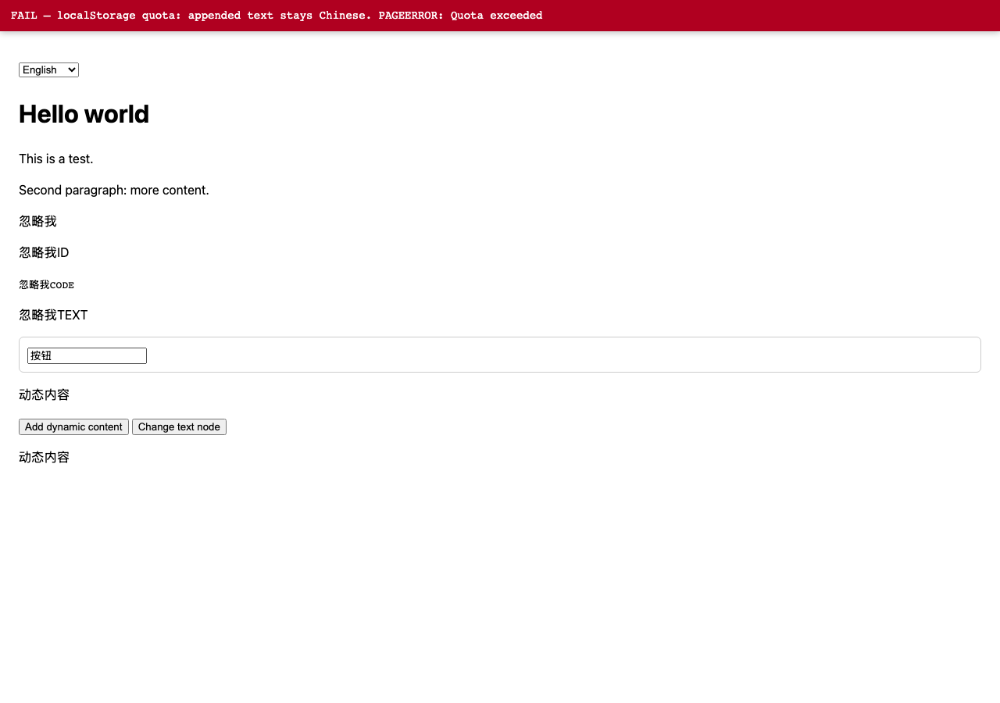

After the quota is exhausted, a dynamically appended node stays in Chinese and the page throws `PAGEERROR: Quota exceeded`. Root cause: `translate.storage.set()` calls `localStorage.setItem()` without a guard (`translate.js:11490`).

With the proposed storage fallback, the same scenario renders:

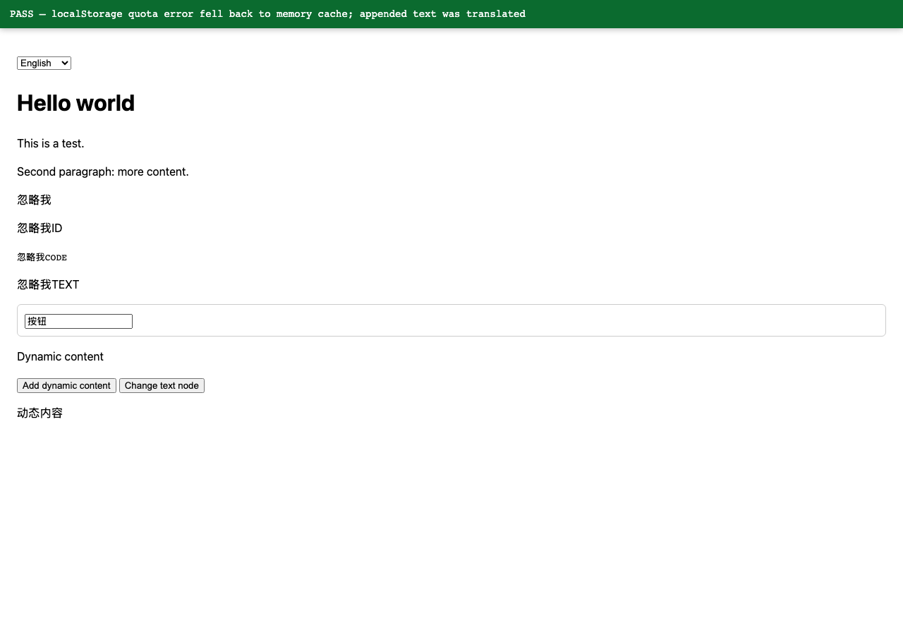

### 2. Disabled storage prevents translation from starting

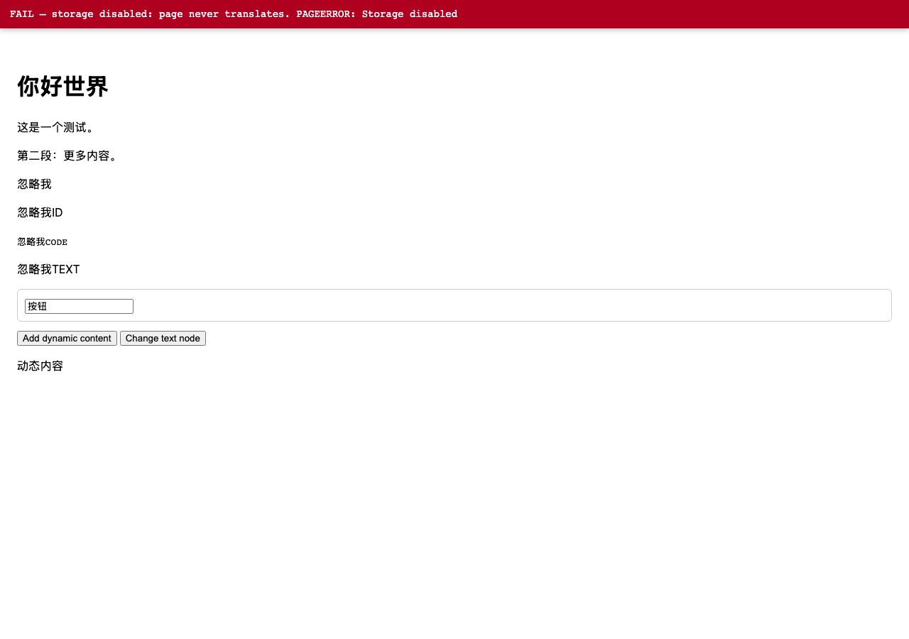

When `localStorage` throws on the first write, the page never translates. With the in-memory fallback:

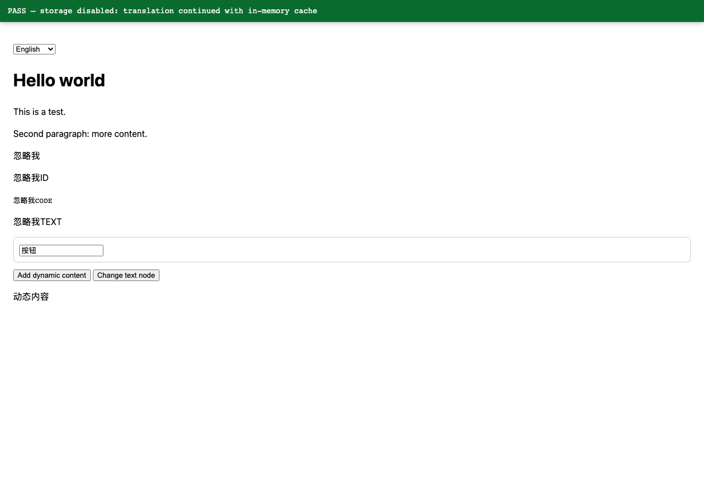

### 3. Nested iframe injection fails

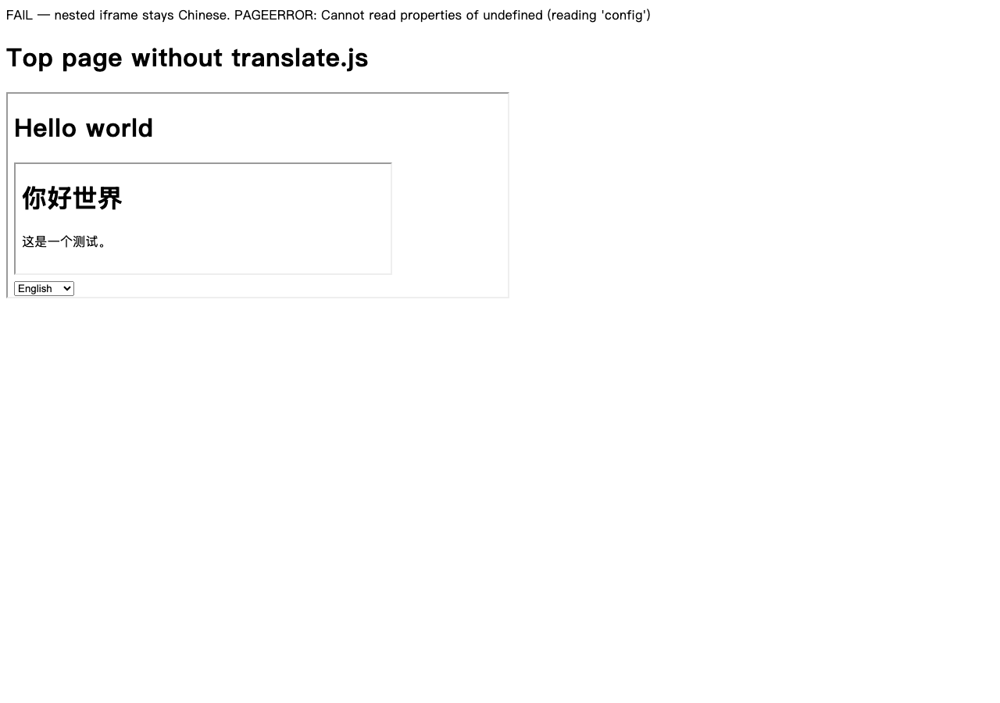

A page with `translate.js` embeds an iframe whose page also embeds an iframe. The middle page translates; the inner page stays Chinese and throws `Cannot read properties of undefined (reading 'config')`. Root cause: the injector reads `parent.translate.config.get()` (`translate.js:5489`) instead of its own `translate.config.get()`.

With the one-line fix:

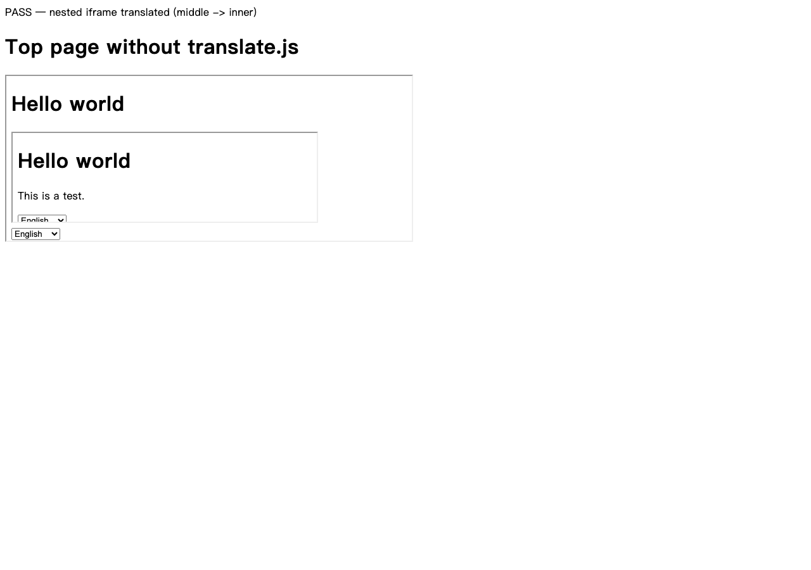

### 4. Shadow DOM is not translated

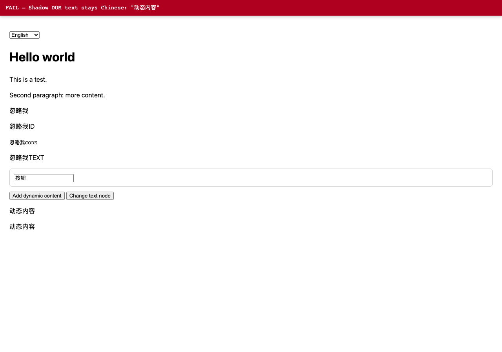

Text inside `attachShadow({ mode: 'open' })` stays in Chinese. This is the known limitation tracked in issues #92 and #101; the existing PR #101 should be tested and reviewed before implementation work starts.

### 5. No public cache-clearing API

The baseline exposes `translate.language.clearCacheLanguage()` but no way to clear translation entries (`hash_*`). The storage resilience PR adds `translate.storage.remove(key)` and `translate.storage.clearCache()`, which clears only `hash_*` keys and returns the number removed.

### 6. Cross-origin `postMessage` is accepted by default

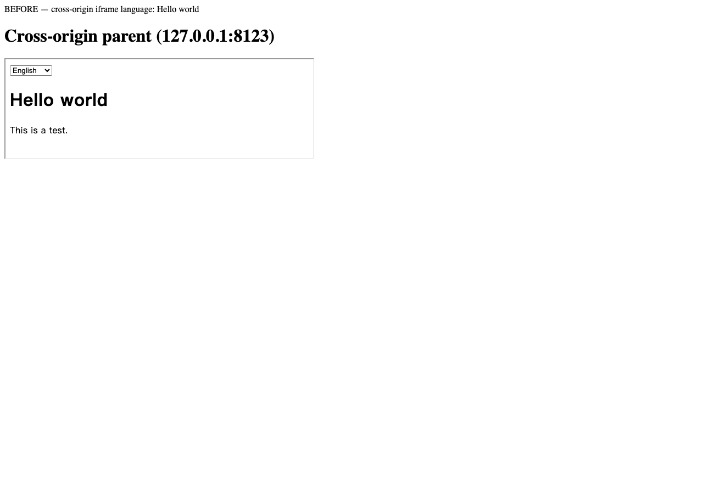

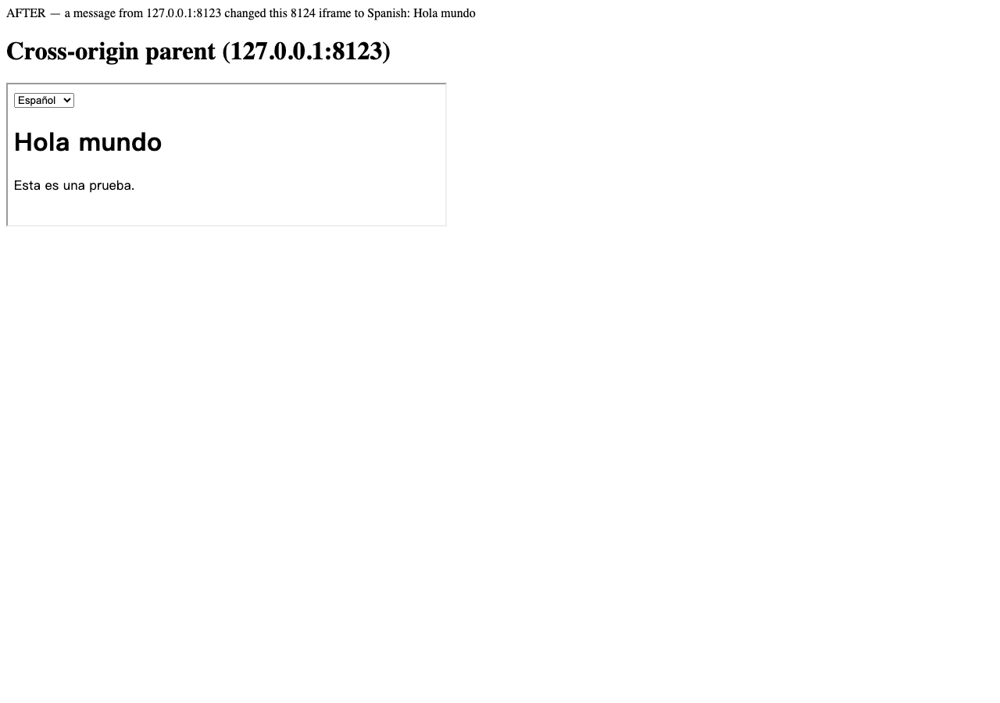

A page on `127.0.0.1:8123` changed the language of an iframe on `127.0.0.1:8124` with a `translate-js-iframe-changeLanguage` message. `allowedOrigins` defaults to `[]`, and `isOriginAllowed()` returns `true` for every origin in that case (`translate.js:797`, `translate.js:931`). This should be a same-origin/referrer allowlist by default, with wildcard support explicit. It is a behavior change, so it needs a maintainer decision before a PR.

## What works

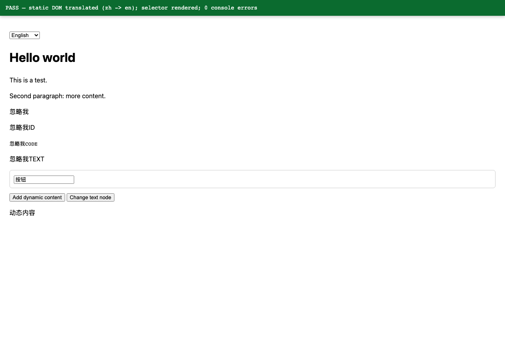

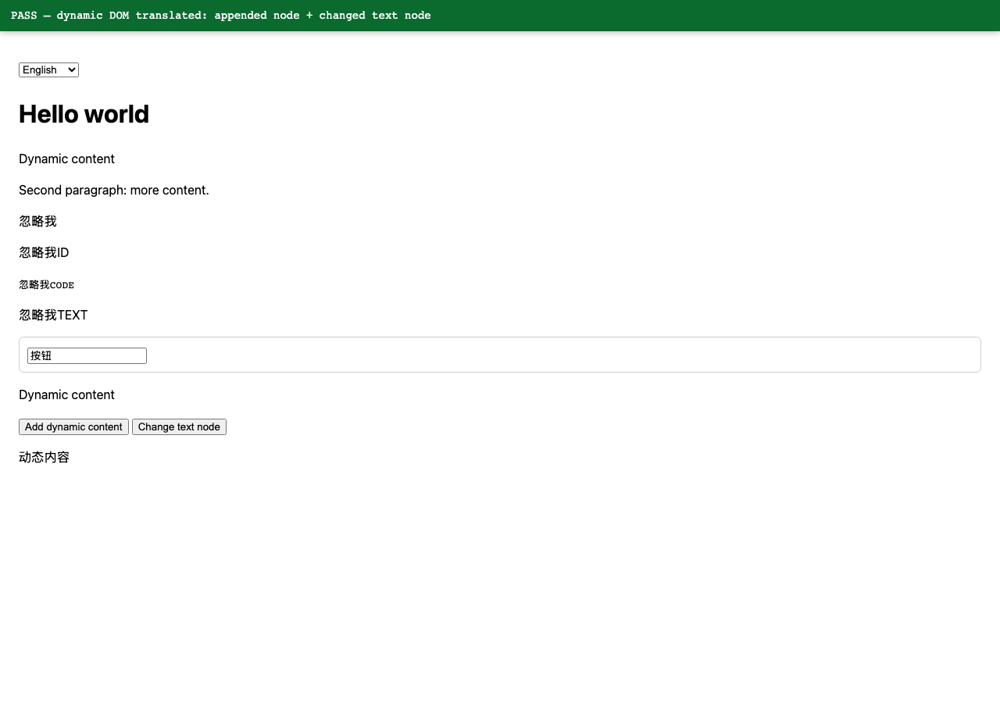

- Static translation and the language selector
- Ignore rules for class, id, tag and text
- `placeholder`, `title` and `alt` translation
- `input.value` translation through `translate.element.tagAttribute`
- `childList` insertion and `characterData` changes
- Language switch and switch back without reload
- Cache hit on reload
- Same-origin iframe injection

## PR map

| PR | Branch | What it changes | Evidence |
|---|---|---|---|
| #111 | `test/e2e-dom-harness` | Adds the Playwright harness, mocked API, fixtures, screenshots and this report. No core behavior change. | Baseline 16/21 |
| #112 | `fix/nested-iframe-config` | One-line fix in `translate.js:5489`; nested iframe test turns green. | `05-nested-iframe-*` |
| #113 | `fix/storage-resilience` | Guards `localStorage`, adds in-memory fallback, `remove()` and `clearCache()`. | `03-*`, `04-*` |

The nested iframe and storage fixes are independent; both rely on the harness in the first PR for regression coverage.

## Competitive context

Top npm i18n packages by weekly downloads (Nov 2026): **i18next** 34.7M, **react-i18next** 25.7M, **vue-i18n** 4.9M. They are manual i18n frameworks, not automatic DOM translators. Top direct website-translation services: **Weglot** (110k+ companies), **ConveyThis** (20k+ websites), **GTranslate** (free widget + paid TDN since 2008).

They have things translate.js does not: per-language URLs/hreflang/server-side SEO, visual editor/TMS, analytics, media OCR, RTL, TypeScript/SSR/framework bindings and CMS integrations. translate.js keeps the opposite tradeoff: MIT, self-hosted, zero configuration, no API key, no per-word pricing and automatic DOM translation.

Do not add TMS, analytics, media OCR or SEO routing to the core. Those belong in TCDN, translate.service or separate packages. The highest-value additions are the test harness, storage resilience, TypeScript definitions, official framework adapters and a provider/privacy guide.
